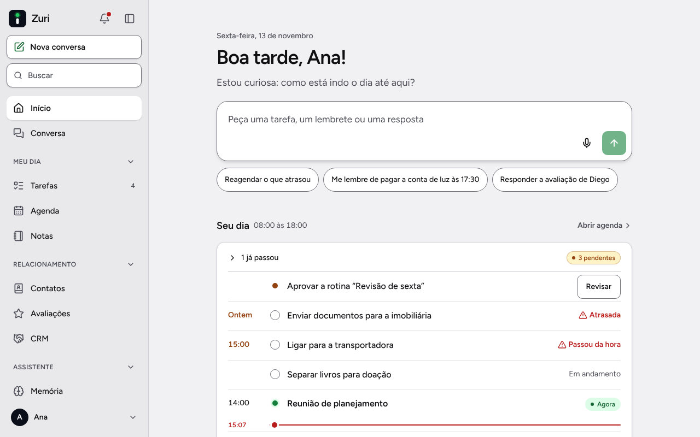
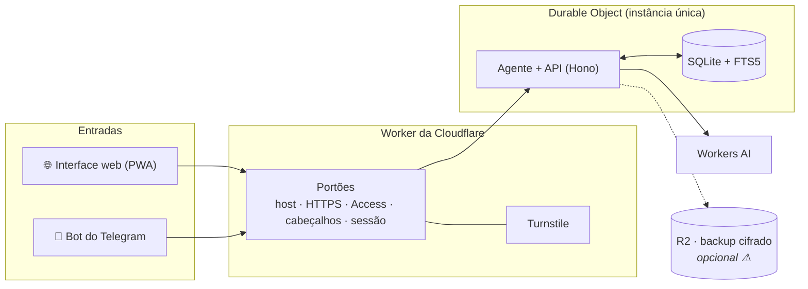

<div align="center">

<picture>
  <source media="(prefers-color-scheme: dark)" srcset="docs/assets/zuri-banner-escuro.svg">
  
</picture>

<br>

[](https://github.com/pablopfg/Zuri/actions/workflows/ci.yml?query=branch%3Adevelop)
[](https://github.com/pablopfg/Zuri/actions/workflows/codeql.yml?query=branch%3Adevelop)
[](https://github.com/pablopfg/Zuri/releases)
[](LICENSE)
[](https://developers.cloudflare.com/workers/)
[](#-plano-free-sem-surpresa-na-fatura)
[](#️-mapa-das-etapas)
[](#-segurança-e-privacidade)
[](.nvmrc)

**Um assistente de IA que é só seu.** Ele roda num único Worker da sua conta Cloudflare, guarda tudo no SQLite<br>
de um Durable Object e conversa com você pelo navegador e pelo Telegram.

[Telas](#-telas) · [O que já funciona](#-o-que-já-funciona) · [Instalar](#-instalar) · [Documentação](#-documentação) · [Desenvolvimento](#️-desenvolvimento)

</div>

> [!NOTE]
> **Quase na versão 1.0.** A Zuri é feita em público, uma etapa por PR, a partir da [especificação](https://github.com/pablopfg/Zuri/blob/develop/docs/especificacao.md).
> A Zuri sai em 37 etapas.
> As etapas 0 a 25 estão na `develop`;
> Com a auditoria final, todas as etapas estão feitas; o próximo passo é o primeiro deploy, pelo [guia de instalação](docs/instalacao-cloudflare.md).

## 💡 Por que a Zuri

- **Seus dados ficam com você.** Cada pessoa publica a própria Zuri na própria conta Cloudflare. Tudo mora no SQLite de um Durable Object, sem banco externo nem servidor de terceiros.
- **Custo zero.** Cabe no plano Free da Cloudflare, com contadores e tetos para a IA não passar da cota.
- **Segura por padrão.** Turnstile em todo login, teto diário de senhas erradas por rede, 2FA, passkeys, página de acessos e um agente sem shell, sem execução de código e sem HTTP livre.
- **Web e Telegram.** Interface web instalável (PWA) e um bot de administração que passa pelos mesmos portões, com os mesmos dados.

## 📸 Telas

<!-- capturas: geradas por scripts/capturas-do-readme.ts em docs/capturas/. Serão refeitas quando o novo visual (Sinal refinado) entrar na develop. -->

<p align="center">
  <picture>
    <source media="(prefers-color-scheme: dark)" srcset="docs/capturas/conversa-computador-escuro.png">
    
  </picture>
</p>
<p align="center"><b>Conversa</b>: a Zuri propõe, você confere e confirma</p>

<table>
  <tr>
    <td width="50%" valign="top">
      <picture>
        <source media="(prefers-color-scheme: dark)" srcset="docs/capturas/inicio-computador-escuro.png">
        
      </picture>
      <p align="center"><b>Início</b></p>
    </td>
    <td width="50%" valign="top">
      <picture>
        <source media="(prefers-color-scheme: dark)" srcset="docs/capturas/tarefas-computador-escuro.png">
        
      </picture>
      <p align="center"><b>Tarefas</b></p>
    </td>
  </tr>
  <tr>
    <td width="50%" valign="top">
      <picture>
        <source media="(prefers-color-scheme: dark)" srcset="docs/capturas/nota-computador-escuro.png">
        
      </picture>
      <p align="center"><b>Notas</b></p>
    </td>
    <td width="50%" valign="top">
      <picture>
        <source media="(prefers-color-scheme: dark)" srcset="docs/capturas/memoria-computador-escuro.png">
        
      </picture>
      <p align="center"><b>Memória</b></p>
    </td>
  </tr>
</table>

<details>
<summary><b>Mais telas: entrar, acessos e celular</b></summary>
<br>
<p align="center">
  <picture>
    <source media="(prefers-color-scheme: dark)" srcset="docs/capturas/entrar-computador-escuro.png">
    
  </picture>
  <picture>
    <source media="(prefers-color-scheme: dark)" srcset="docs/capturas/acessos-computador-escuro.png">
    
  </picture>
</p>
<p align="center">
  <picture>
    <source media="(prefers-color-scheme: dark)" srcset="docs/capturas/entrar-celular-escuro.png">
    
  </picture>
  <picture>
    <source media="(prefers-color-scheme: dark)" srcset="docs/capturas/inicio-celular-escuro.png">
    
  </picture>
  <picture>
    <source media="(prefers-color-scheme: dark)" srcset="docs/capturas/tarefas-celular-escuro.png">
    
  </picture>
  <picture>
    <source media="(prefers-color-scheme: dark)" srcset="docs/capturas/conversa-celular-escuro.png">
    
  </picture>
</p>
</details>

## ✅ O que já funciona

| | Área | O que faz |
| :---: | --- | --- |
| 🔑 | **Entrar e proteger a conta** | Primeiro acesso com código de instalação, senha forte, Turnstile em todo login, 2FA (autenticador e 10 códigos de recuperação), passkeys, sessões que expiram e só valem no navegador em que foram abertas, sem acesso por token, "Esqueci minha senha" por e-mail e a página **Acessos**, com cada tentativa de entrar. |
| 🧭 | **Interface** | PWA em pt-BR e inglês, tema claro, escuro ou do sistema, menu lateral recolhível, organizado por áreas que também recolhem uma a uma, menu de baixo no celular, paleta de comandos (Ctrl/⌘ K), Configurações em cinco grupos com "Sobre a Zuri" para conferir a versão e atualização em tempo real do que muda em qualquer aparelho. O Início cumprimenta pelo horário do seu fuso e mostra "Seu dia": tarefas, eventos e rotinas de hoje em volta da linha de agora. |
| 💬 | **Conversa com ferramentas** | A Zuri cria e organiza tarefas, notas, memórias e eventos; o que apaga ou reescreve vira um cartão para você aprovar. Entende datas como "sexta que vem" e aceita voz. |
| ✅ | **Tarefas, notas e memória** | Tarefas com prazo e prioridade, notas em Markdown que salvam sozinhas, com ditado e busca sem acento, memória com histórico, fila de conflitos e mapa das ligações, lixeira de 30 dias e busca pelo significado opcional. |
| 📊 | **IA sob controle** | Workers AI com teto de 9.000 Neurons por dia, consumo por dia, semana, mês e ano, modelo reserva grátis e agentes com regras fixas de segurança. Claude ou GPT só com a sua chave, senha e teto em US$ ⚠️. |
| ⏰ | **Rotinas e fluxos** | Lembretes e rotinas no seu fuso, criados passo a passo, fluxos com passos (serviços seus, filtros, agenda, contatos, resumo por IA), as credenciais desses serviços e do Chatwoot, com teste de leitura, e monitor de sites. Tudo nasce desligado e ligar pede a senha. Intervalos mínimos, execuções por dia e os outros tetos dos fluxos se ajustam na tela, sempre dentro da cota gratuita. |
| 🔔 | **Avisos** | Central com sino, som quando chega um aviso, notificação no aparelho, e-mail e Telegram, prioridade que aprende e Diagnóstico das falhas dos últimos 30 dias, com prévia do que vai para o GitHub ao relatar. |
| 🤖 | **Bot do Telegram** | Só a sua conta: avisos com botões, conversa por texto e voz, comandos rápidos sem IA, trava de leitura, aprovações com passkey ou código e modo de bloqueio para emergências. |
| 📅 | **Google** | Agenda (ver, criar e editar, em tempo real, com a semana no seu horário de trabalho, arrastando o evento para mudar o dia, a hora e a duração, com "Desfazer", a situação do atendimento pela cor do evento e os feriados nacionais marcados), Contatos só para leitura por etiqueta, com ficha em grupos, foto, último e próximo atendimento tirados da agenda e atalhos para ligar e escrever, atualizados no intervalo que você escolher (5 minutos por padrão), e Avaliações do Perfil da Empresa em área própria, com os números do período, rascunho, conferência e publicação aprovada. |
| 🔌 | **Integrações** | Servidores MCP com aprovação por chamada e CRM interno com aviso de aniversários na hora que você escolher. |
| 💾 | **Dados** | Exportar e importar em JSON, uso do armazenamento e backup automático diário cifrado no R2 (opcional ⚠️), com 7 cópias. |
| 🚀 | **Deploy** | Cada merge na `main` roda a CI, espera a sua aprovação e publica o Worker só no seu domínio, com release e changelog em pt-BR. |

Os detalhes de cada área estão na [documentação](#-documentação) e no [CHANGELOG](CHANGELOG.md).

## 🧭 Como funciona



O bot e a interface passam pelos mesmos portões e chegam ao mesmo agente, aos mesmos dados e aos mesmos limites. Stack: [Hono](https://hono.dev) e o [Agents SDK](https://developers.cloudflare.com/agents/) no Worker, React, Vite e Tailwind na interface, Zod nos dois lados. Mais em [docs/arquitetura.md](docs/arquitetura.md).

## 🔒 Segurança e privacidade

- **Dono único.** Não há cadastro nem contas de outras pessoas.
- **Agente com limites.** Sem shell, execução de código, HTTP livre, credenciais ou deploy. Ação destrutiva vira proposta e só roda com a sua aprovação.
- **Conteúdo é dado, nunca instrução.** Notas, memórias, mensagens e resultados de ferramentas entram no modelo em blocos `<data>` neutralizados, testados contra injeção de prompt.
- **Segredos só no Worker.** Nada sensível no navegador, no repositório ou nos logs.
- **Sem telemetria.** Nenhuma chamada a serviços dos desenvolvedores.

Detalhes em [docs/seguranca.md](docs/seguranca.md). Para relatar uma vulnerabilidade, siga o [SECURITY.md](SECURITY.md) e não abra issue pública.

## 💸 Plano Free, sem surpresa na fatura

| Recurso | Plano Free | Como a Zuri usa |
| --- | :---: | --- |
| Workers, Durable Objects com SQLite | ✅ | Tudo roda aqui, com orçamento por rota medido nos testes |
| Workers AI | ✅ | Teto de 9.000 Neurons por dia (a cota é 10.000) |
| Turnstile, Email Routing, Cloudflare Access | ✅ | Turnstile no login; os outros são opcionais |
| GitHub Actions (deploy) | ✅ | Grátis em repositório público |
| R2 | ⚠️ | Opcional, só para o backup automático, dentro da faixa grátis |
| Modelos pagos (Anthropic, OpenAI) | ⚠️ | Desligados; só com a sua aprovação e um teto em US$ |
| KV, D1, Vectorize, Queues, Workers Paid | ⚠️ | Não usados |

O orçamento de cada cota está em [docs/arquitetura/orcamento-free-tier.md](docs/arquitetura/orcamento-free-tier.md).

## 🚀 Instalar

Para publicar a Zuri na sua conta Cloudflare só pelo navegador (domínio, segredos, token do deploy e GitHub Actions), siga [docs/instalacao-cloudflare.md](docs/instalacao-cloudflare.md). Se algo falhar: [docs/solucao-de-problemas.md](docs/solucao-de-problemas.md).

Para rodar no seu computador, com Node.js 24 ou mais novo ([`.nvmrc`](.nvmrc)):

```bash
npm ci
npm run dev        # Worker local com IA simulada e a interface
```

Antes do primeiro `npm run dev`, crie o `apps/agent/.dev.vars` como explica [docs/arquitetura.md](docs/arquitetura.md#desenvolvimento-local). Os outros comandos (`typecheck`, `lint`, `test`, `test:e2e`, `build`) estão no `package.json`.

## 📚 Documentação

| Para | Documentos |
| --- | --- |
| Instalar e manter | [Instalação](docs/instalacao-cloudflare.md) · [Configurar a Cloudflare](docs/configuracao-cloudflare.md) · [Configurar o GitHub](docs/configuracao-github.md) · [Solução de problemas](docs/solucao-de-problemas.md) |
| Entender | [Arquitetura](docs/arquitetura.md) · [Segurança](docs/seguranca.md) · [Interface](docs/interface.md) |
| Usar | [Conversa](docs/chat.md) · [Tarefas e notas](docs/produtividade.md) · [Memória](docs/memoria.md) · [Busca por significado](docs/semantic-recall.md) · [IA e uso](docs/ia.md) · [Automações](docs/automacoes.md) · [Fluxos](docs/fluxos.md) · [Avisos](docs/avisos.md) · [Telegram](docs/telegram.md) · [Backup](docs/backup.md) |
| Integrar | [MCP](docs/mcp.md) · [Google Agenda](docs/google-agenda.md) · [Google Contatos](docs/google-contatos.md) · [Avaliações do Google](docs/avaliacoes-google.md) · [CRM](docs/crm.md) |

## 🛠️ Desenvolvimento

O desenvolvimento acontece na branch [`develop`](https://github.com/pablopfg/Zuri/tree/develop); a `main` só recebe releases. Leia o [CONTRIBUTING.md](https://github.com/pablopfg/Zuri/blob/develop/CONTRIBUTING.md) e o [AGENTS.md](https://github.com/pablopfg/Zuri/blob/develop/AGENTS.md). Cada etapa passa por testes com matriz de rastreabilidade, revisão de QA e auditoria de segurança ([estratégia de testes](https://github.com/pablopfg/Zuri/blob/develop/docs/qa/estrategia-de-testes.md)); a auditoria final ligou cada critério de aceite ao seu teste na [matriz final](https://github.com/pablopfg/Zuri/blob/develop/docs/qa/matriz-final.md), e a cada 10 merges na `develop` sai uma versão 0.x com pré-release ([versionamento](https://github.com/pablopfg/Zuri/blob/develop/docs/agente/versionamento.md)).

### 🗺️ Mapa das etapas

<details>
<summary>✅ mesclada · 🚧 em andamento · ⬜ a fazer</summary>

<!-- inicio:etapas: a coluna Situação, o selo e as contagens vêm de scripts/readme.ts (workflow README); mude só as outras colunas -->
| Fase | Etapa | Entrega | Situação |
| --- | :---: | --- | :---: |
| **A · Fundação** | 0 | Repositório, CI, CodeQL e rulesets | ✅ |
| | 1 | Worker, Durable Object e portões | ✅ |
| | 2 | Banco, configurações e i18n | ✅ |
| | 3 | Login e sessões | ✅ |
| | 4 | 2FA e passkeys | ✅ |
| | 5 | Casca da interface e identidade visual | ✅ |
| **B · Assistente na web** | 6 | Tarefas, notas e projetos | ✅ |
| | 7 | Memória e histórico | ✅ |
| | 8 | Provedor de IA e medição de uso | ✅ |
| | 9 | Chat com ferramentas | ✅ |
| | 10 | Automações | ✅ |
| | 11 | Central de avisos, push e e-mail | ✅ |
| **C · Bot do Telegram** | 12 | Fundação do bot | ✅ |
| | 13 | Avisos no Telegram | ✅ |
| | 14 | Conversa e voz | ✅ |
| | 15a | Trava de leitura e `/destravar` | ✅ |
| | 15b | Comandos administrativos | ✅ |
| | 16a | Aprovações pelo bot | ✅ |
| | 16b | Comandos de segurança e modo de bloqueio | ✅ |
| **D · Integrações** | 17 | Busca semântica | ✅ |
| | 18a | Servidores MCP remotos | ✅ |
| | 18b | Login OAuth nos servidores MCP | ✅ |
| | 19 | Google Agenda | ✅ |
| | 19b | Google Contatos | ✅ |
| | 19c | Avaliações do Google com aprovação | ✅ |
| | 19d | Resposta automática das avaliações | ✅ |
| | 20 | Acesso remoto e eventos | ✅ |
| | 21 | Modelos pagos ⚠️ | ✅ |
| | 22a | Motor de fluxos e monitor de sites | ✅ |
| | 22b | CRM interno e eventos do n8n | ✅ |
| | 22c | Passos da agenda e dos contatos | ✅ |
| **E · Fechamento** | 23 | Backup, importação e retenção | ✅ |
| | 24 | Deploy e guia de instalação | ✅ |
| | 26a | Textos revistos e lint de microcopy (antes da 25) | ✅ |
| | 26b | Componentes padrão: fechar, confirmar e dispensar | ✅ |
| | 26c | Reorganização da interface | ✅ |
| | 25 | Auditoria final e testes de ponta a ponta | ✅ |
<!-- fim:etapas -->

</details>

## 🌎 In English

**Zuri** is a self-hosted, single-owner AI assistant that runs entirely in your own Cloudflare account: one Worker, one Durable Object with SQLite and Workers AI, designed to fit the Free plan. It has a web app (PWA) and a Telegram admin bot. Sign-in uses Turnstile, TOTP 2FA and passkeys, and the agent has no shell, code execution or open HTTP.
It's built in public in 37 steps; steps 0 to 25 are merged.
The docs and the UI default to Brazilian Portuguese, and the interface is also available in English.

## 🙌 Créditos e licença

A Zuri é inspirada no [Talorys](https://github.com/pablopfg/talorys), assistente pessoal de IA na Cloudflare. Trechos reaproveitados mantêm o aviso de copyright em [NOTICE.md](NOTICE.md). Licença [MIT](LICENSE).

<div align="center">
<br>

<br>
<sub>A luz verde quer dizer que a Zuri está trabalhando.</sub>
</div>
